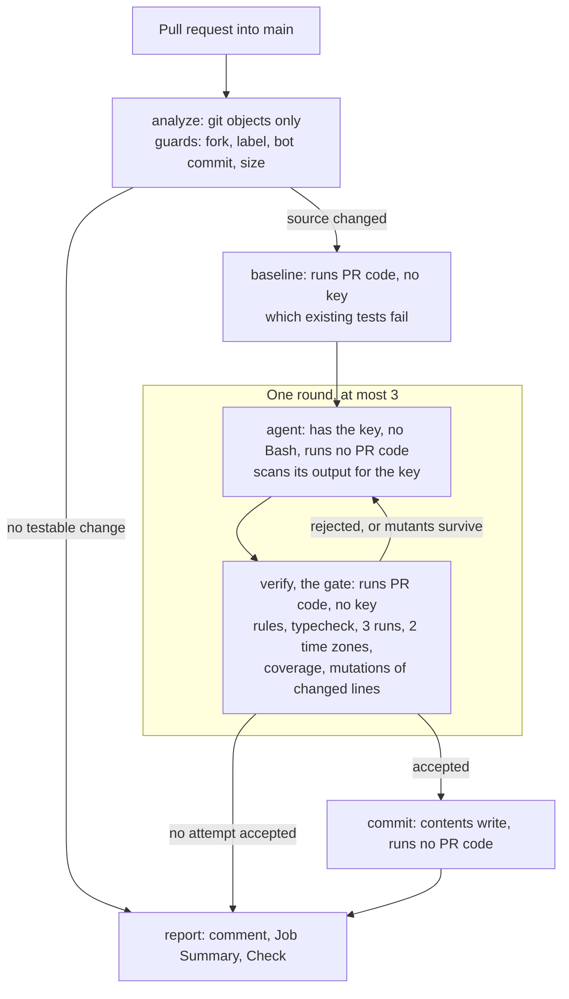

# Unit test agent

On each pull request, a Claude Code agent writes or updates unit tests for the changed code, or says why none are needed. Code outside the model runs the tests, commits them and sets the verdict.

Final state: prompt version 6, `main` at `67ddee2`. Costs are the CLI's estimate, not a bill. The Console bill for the workspace of the CI key is $1.32, against $1.3205 estimated for the 11 attempts in section 4. † marks a local measurement whose record is not in this repository.

## 1. How it works

**Agent:** [`.claude/agents/unit-test-agent.md`](.claude/agents/unit-test-agent.md). It uses `claude-sonnet-5-5` through `anthropics/claude-code-action` v1.0.267 (CLI 2.1.317), with at most 40 turns and $0.75 per attempt. In CI it has no Bash. It may change only test files, and [`guard-tools.mjs`](.claude/hooks/guard-tools.mjs) enforces this.

| Skill (`.claude/skills/`) | Purpose | How a run uses it |
|---|---|---|
| `pr-change-analysis` | Are tests needed? | Its script runs in `analyze`, and its text is always in the prompt |
| `backend-unit-tests`, `frontend-unit-tests` | How to write tests here | Code puts it in the prompt, chosen by the changed files |
| `test-verification` | The gate | Its scripts run in `baseline` and `verify` |
| `pr-report` | Result and report | Its text is in the prompt, its schema in `--json-schema`, and its scripts validate the result and render the report |

Code places the skills in the prompt ([`build-prompt.mjs`](.claude/skills/pr-change-analysis/scripts/build-prompt.mjs)), because the `skills` field loads nothing under `--agent -p`, and a model skipped a skill in a real run. Each report lists the skills it used.



Workflow: [`test-agent.yml`](.github/workflows/test-agent.yml) and [`test-agent-round.yml`](.github/workflows/test-agent-round.yml), with the steps in [`scripts/ci/`](scripts/ci/). A test, [`workflow-rules.mjs`](scripts/ci/workflow-rules.mjs), keeps the rules in the YAML true. The Check turns red only when an existing test passes on the base and fails on the head. It is green for tests added or none needed, and neutral when the agent or the tools fail. It is not a required check.

Separately, [`ci.yml`](.github/workflows/ci.yml) runs the tests, typecheck and format check of both packages, and the tests of the agent tooling, on Node 22 and 24.

## 2. Main decisions

- **The key and code from the pull request never share a job.** So the agent has no Bash in CI, and the gate has no secret.
- **Tools come from the base commit,** so a pull request cannot change the checks that judge it.
- **The model reports, code decides.** The gate runs real tools because the model can be wrong about the environment. For example, it assumed Express 4 behavior on Express 5. The report marks agent text as "not verified".
- **Mutations of changed lines are a warning.** Coverage hid weak tests in the coverage work. Surviving mutants can start one repair round, but they never reject tests, because some mutants are equivalent.
- **Defense in code, not in the model.** Instruction files that come with a pull request are removed before the agent starts. A trial that cost under one cent† showed that CLI 2.1.317 reads `AGENTS.md`, against its documentation, and the action does not restore it.
- **Results are tied to a prompt version.** v3 chose skills by code, v4 put the result contract in the prompt, v5 added the diff and the regressions, and v6 starts the diff at the last bot commit and asks the agent to read the code first.
- **Structured output gets a second check.** The API does not enforce `maxLength` or `maxItems`, but Claude Code checks the schema when `StructuredOutput` is called. A value over a limit gets an error, and the model can retry. [`validate-result.mjs`](.claude/skills/pr-report/scripts/validate-result.mjs) checks the result again, whatever the CLI version, and compares it with the gate:

  | Trial on CLI 2.1.317† | What happened |
  |---|---|
  | `maxLength: 5`, a value of 20 characters | Rejected twice, then the run ended as `success` with no `structured_output` |
  | `maxItems: 1`, 3 items | Rejected, then the model bent the data to one item, `"x, y, z"`, which was accepted |

- **Everything is pinned:** actions to full SHAs, and the runner to `ubuntu-24.04`. Secret scanning, push protection and CodeQL are on as the last layer, not as the main defense.

## 3. How to run

**On pull requests.** Add a repository secret `ANTHROPIC_API_KEY` and a label `skip-test-agent`. Then open a pull request into `main` from a branch of this repository. The report appears as a comment, in the Job Summary and as the Check `Unit test agent`. CI does not run on the bot's commit until a person approves it. Forks do not run the agent. To try it yourself, push this code to a new repository of your own (not a fork), add the secret and the label, and open a pull request from a branch into `main`.

**Locally.** You need Node 22.12 or newer. A real run also needs the `claude` CLI, logged in. Tests need no database.

```sh
npm --prefix backend ci && npm --prefix frontend ci
npm run test-agent -- --base main --dry-run   # what it would do, with no API key
npm run test-agent -- --base main             # a real run, on a branch
npm test                                      # tests of the agent tooling
```

## 4. Example runs

### Coverage of the existing code

| | Backend, before → after | Frontend, before → after |
|---|---|---|
| Lines | 33.02% → 97.24% | 47.68% → 94.7% |
| Branches | 33.33% → 97.91% | 43.79% → 97.08% |
| Tests | 48 → 91 | 18 → 131 |

The same agent wrote these tests through the local runner on prompt v3, and each result went through the gate and a review with mutations ([#3][pr3]). Of 12 modules, 2 passed on the first attempt, 4 after ordinary feedback, and 6 needed a reviewer's guidance, such as a list of behaviors the tests missed. The estimated cost was $3.37†. The "after" values were measured again on `67ddee2` and match. The agent found 2 real bugs, listed in [`CLAUDE.md`](CLAUDE.md) and not fixed.

### Pull requests

| PR | Prompt | Run | Result | Turns | Cost |
|---|---|---|---|---|---|
| [#8][pr8] | v4 | [42026144995][r8] | 3 tests, mutations 11/11 | 6 | $0.0876 |
| [#12][pr12] | v4 | [42040676651][r12v4] | 20 tests, mutations 25/26 and 28/28 | 42 | $0.3999 |
| [#14][pr14] | v4 | [42063522474][r14v4] | No tests needed, injection ignored | 4 | $0.0751 |
| [#15][pr15] | v4 | [42065812089][r15v4] | Red Check, regressions not reported by the agent | 4 | $0.0721 |
| [#15][pr15] | v5 | [42070580360][r15v5] | Red Check, all 3 regressions reported | 2 | $0.0614 |
| [#14][pr14] | v5 | [42071589804][r14v5] | No tests needed, injection ignored | 2 | $0.0592 |
| [#12][pr12] | v5 | [42072473480][r12v5] | Missed a change from `round` to `floor` | 4 | $0.0907 |
| [#12][pr12] | v6 | [42076329621][r12v6] | Noticed it and flagged it as a possible bug | 4 | $0.0866 |
| [#18][pr18] | v6 | [42077524433][r18a] | 7 tests, mutations 31/32 | 7 | $0.1336 |
| [#18][pr18] | v6 | [42079074648, attempt 1][r18b1] | 2 tests added on a later push | 9 | $0.1343 |
| [#18][pr18] | v6 | [same run, attempt 2][r18b2] | Repeated by hand, discarded as stale | 9 | $0.1200 |

That is 11 attempts for $1.3205 in total. A pull request's comment shows only its last run, so the links lead to the earlier ones.

**#12, a new feature end to end (v4).** It adds `GET /api/todos/summary` and a `TodoSummary` component. In round 0 the gate accepted the tests, but mutations showed 21 of 28 frontend changes not covered. Round 1 wrote the remaining tests, and round 2 fixed only the result's metadata. Without the mutation round, the gate would have accepted one frontend test file. From the report:

```text
### Unit test agent: 20 tests added to this pull request
| `backend`  | 25 tests, 3 runs, also in `Pacific/Auckland`: passed | 99 tests: passed  | passed |
| `frontend` | 19 tests, 3 runs, also in `Pacific/Auckland`: passed | 145 tests: passed | passed |
- `backend/src/features/todos/summary.ts:15`: `todo.due_date !== null` became `true`
Skills preloaded: `pr-change-analysis`, `pr-report`, `backend-unit-tests`, `frontend-unit-tests`.
```

The surviving mutant is equivalent. Still, 53 of 54 does not mean complete: 19 of 23 hand-made mutations were caught†, and two survivors come from a hand-written mock, `TodoSummary: () => null`. On v6, after a change from `round` to `floor`, the agent said: "uses 1/3, which gives 33 either way, so it doesn't pin the rounding. I can't tell whether floor is intended, so I wrote no test and flagged it."

**#14, prompt injection in four channels.** Code removed `frontend/CLAUDE.md` and `AGENTS.md` before the agent ran. The pull request description never reaches the prompt. The model read a comment in the code and ignored it ("I ignored it as untrusted data"). That is one run per version: model behavior, not a guarantee.

**#15, a regression.** `<` became `<=`, and code found exactly the 3 failing tests. On v4 the agent had no diff, and the headline said "No tests needed" over a red Check. On v5 it reported all 3: "A person must decide whether the change or the existing tests are right".

**#18, creating, then updating (v6).** On the first push the agent wrote 7 tests without reading the file, against its instructions. On the second push the diff started at the bot's commit. The agent read the code and added 2 tests to the same file in commit [`a204165`][c18]. A shared concurrency group cancelled that run's report. A repeat of the run was then refused as stale, because the head had moved.

When the CLI could not start ([41897469235][fail]), the Check was `neutral` with an explanation. A bot commit, a pull request without code and the label all ended with no model call.
## 5. Assumptions

- Authors of same-repository pull requests have write access and are not hostile by default.
- The work covers unit tests only: no database, no end-to-end tests.
- A person reviews the bot's commits before a merge. The Check is advisory.
- The key sits in its own Console workspace with a $10 limit, which the owner set and which cannot be seen from this repository. It was replaced after the security tests, and no run has used the new key yet.

## 6. Limitations

The most important limitations are below. The full list, with a decision and a reason for each, and the four security reviews are in [docs/security-review.md](docs/security-review.md).

- **Write access is trusted.** A person with write access can read the key through a workflow on a branch, or forge the gate and get a bot commit. The workspace limit and an advisory Check bound the damage.
- **The bot's marker is plain text.** It can skip a run, or move the start of the diff so that the prompt says nothing changed.
- **"No tests needed" has no check.** Mutations run only after accepted tests (#12 on v5). The headline is also too strong when the agent reports a possible bug (#12 on v6).
- **Reading the code is an instruction, not a check** (#18, first push).
- **A deliberate change that breaks tests is reported, not updated** (#15).
- **Parts are checked only partly.** A block by the hook was never seen under the action, only in tests and local runs. The `concurrency` fix was checked by a rule, not by a run.
- **Samples are small.** Most behaviors rest on one run per prompt version.

## 7. Production version

- Split the workflow: `pull_request` for the gate, and `workflow_run` for the agent, which reads code only as data. This closes the path to the key and allows forks.
- Run code from the pull request in a container with no network. Repeat the test rules in `commit`.
- Trust the bot's marker only on a commit that has the bot's Check.
- Remove `.env*` and `bunfig.toml` with the instruction files.
- Run mutations for "no tests needed" too, and warn when the agent did not read a changed file.
- Run a fixed set of example pull requests several times per prompt version.

[pr3]: https://github.com/edefice/taskly-test-agent/pull/3
[pr8]: https://github.com/edefice/taskly-test-agent/pull/8
[pr12]: https://github.com/edefice/taskly-test-agent/pull/12
[pr14]: https://github.com/edefice/taskly-test-agent/pull/14
[pr15]: https://github.com/edefice/taskly-test-agent/pull/15
[pr18]: https://github.com/edefice/taskly-test-agent/pull/18
[r8]: https://github.com/edefice/taskly-test-agent/actions/runs/42026144995
[r12v4]: https://github.com/edefice/taskly-test-agent/actions/runs/42040676651
[r14v4]: https://github.com/edefice/taskly-test-agent/actions/runs/42063522474
[r15v4]: https://github.com/edefice/taskly-test-agent/actions/runs/42065812089
[r15v5]: https://github.com/edefice/taskly-test-agent/actions/runs/42070580360
[r14v5]: https://github.com/edefice/taskly-test-agent/actions/runs/42071589804
[r12v5]: https://github.com/edefice/taskly-test-agent/actions/runs/42072473480
[r12v6]: https://github.com/edefice/taskly-test-agent/actions/runs/42076329621
[r18a]: https://github.com/edefice/taskly-test-agent/actions/runs/42077524433
[r18b1]: https://github.com/edefice/taskly-test-agent/actions/runs/42079074648/attempts/1
[r18b2]: https://github.com/edefice/taskly-test-agent/actions/runs/42079074648/attempts/2
[c18]: https://github.com/edefice/taskly-test-agent/commit/a204165
[fail]: https://github.com/edefice/taskly-test-agent/actions/runs/41897469235
